# Coffee-shop lesson graphs

Generated from the executable LangGraph definitions. Read the curriculum in `packages/tutorials/src/coffee-shop/coffee-shop-curriculum.ts`; each phase has its script, actions, and evidence in `lessons/<phase>.ts`.

Each invocation handles one learner event. An edge to `__end__` at a wait means the workflow stops until another approval, save, request, REPL observation, or answer arrives. It does not perform that learner action automatically. Milo's file-writing nodes call their tools only for an explicit approved edit, and checks run only for check events. The browser controls message pacing; the project journal records durable lesson completion.

After a phase completes, the parent workflow saves progress and either continues within the same lesson or waits for Next Lesson. Older project protocols keep their original lesson inventory.

Regenerate after building tutorials: `node scripts/describe-tutorial-workflow.mjs > packages/tutorials/WORKFLOW.md`.

## Lesson 1: Try the coffee shop (orientation)

[Read the script and graph](./src/coffee-shop/lessons/orientation.ts#L1).

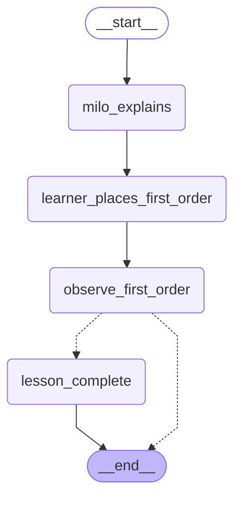

## Lesson 2: Explore your generated API (explore)

[Read the script and graph](./src/coffee-shop/lessons/explore.ts#L1).

```mermaid
%%{init: {'flowchart': {'curve': 'linear'}}}%%
graph TD;
	__start__([<p>__start__</p>]):::first
	milo_explains(milo_explains)
	learner_inspects_and_refreshes(learner_inspects_and_refreshes)
	observe_generated_products(observe_generated_products)
	lesson_complete(lesson_complete)
	__end__([<p>__end__</p>]):::last
	__start__ --> milo_explains;
	learner_inspects_and_refreshes --> observe_generated_products;
	lesson_complete --> __end__;
	milo_explains --> learner_inspects_and_refreshes;
	observe_generated_products -.-> lesson_complete;
	observe_generated_products -.-> __end__;
	classDef default fill:#f2f0ff,line-height:1.2;
	classDef first fill-opacity:0;
	classDef last fill:#bfb6fc;

```

## Lesson 3: Give generated descriptions coffee examples (description-example)

[Read the script and graph](./src/coffee-shop/lessons/description-example.ts#L1).

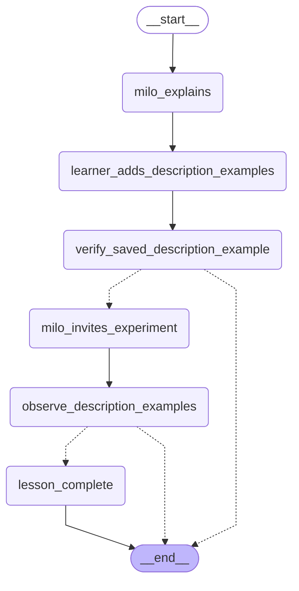

## Lesson 4: Replace random products (catalog)

[Read the script and graph](./src/coffee-shop/lessons/catalog.ts#L1).

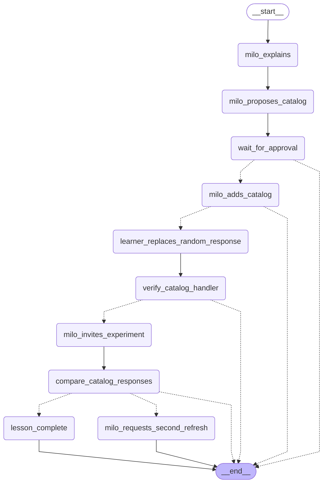

## Lesson 5: Respond to the order you received (order)

[Read the script and graph](./src/coffee-shop/lessons/order.ts#L1).

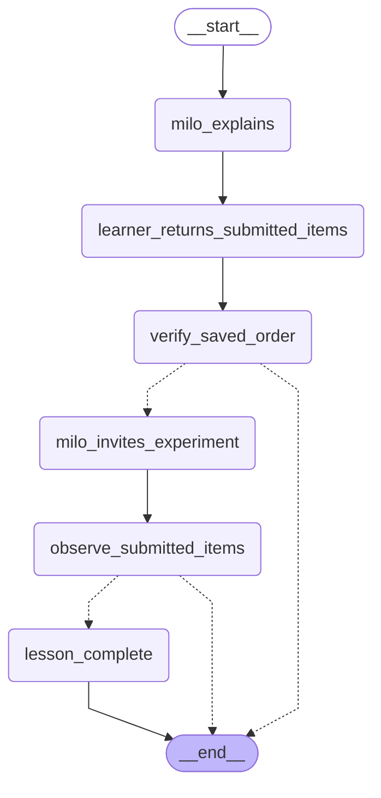

## Lesson 6: Add failure and recovery (fail)

[Read the script and graph](./src/coffee-shop/lessons/fail.ts#L1).

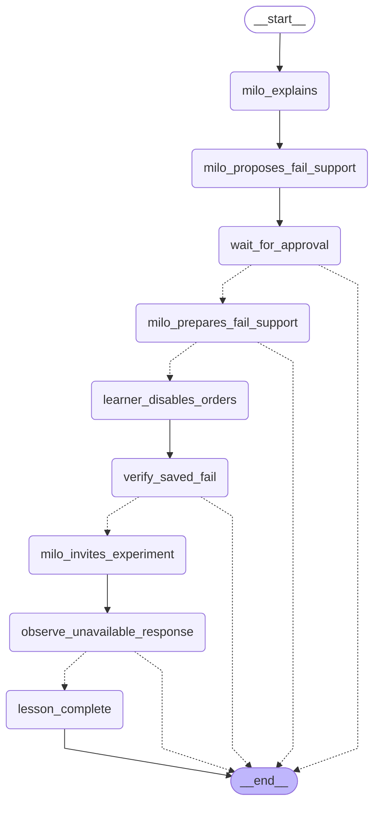

## Lesson 6: Add failure and recovery (retry)

[Read the script and graph](./src/coffee-shop/lessons/retry.ts#L1).

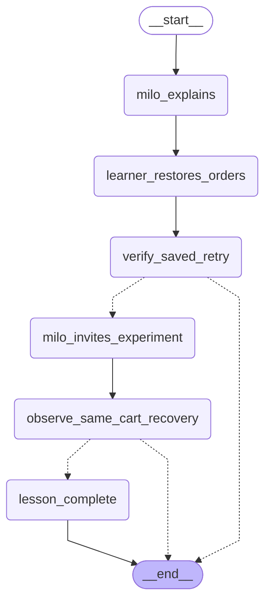

## Lesson 7: Introduce shared context (context)

[Read the script and graph](./src/coffee-shop/lessons/context.ts#L1).

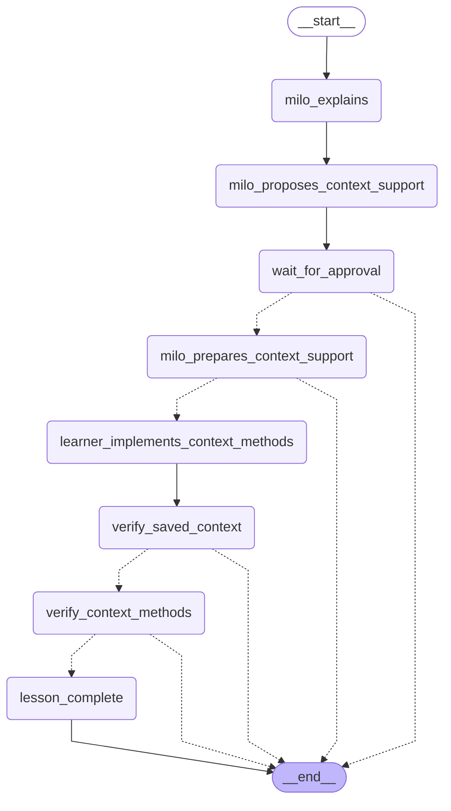

## Lesson 8: Connect routes and the REPL (connect)

[Read the script and graph](./src/coffee-shop/lessons/connect.ts#L1).

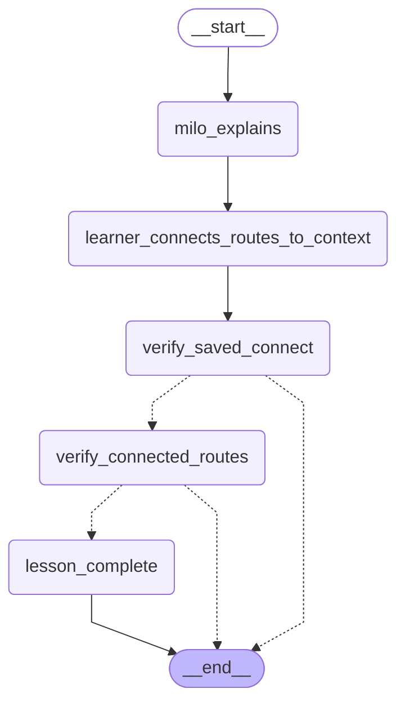

## Lesson 8: Connect routes and the REPL (context-repl)

[Read the script and graph](./src/coffee-shop/lessons/context-repl.ts#L1).

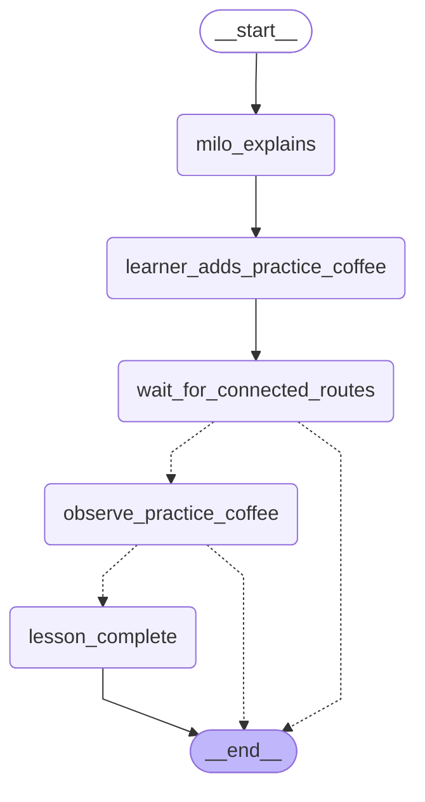

## Lesson 9: Initialize context with scenarios (seed)

[Read the script and graph](./src/coffee-shop/lessons/seed.ts#L1).

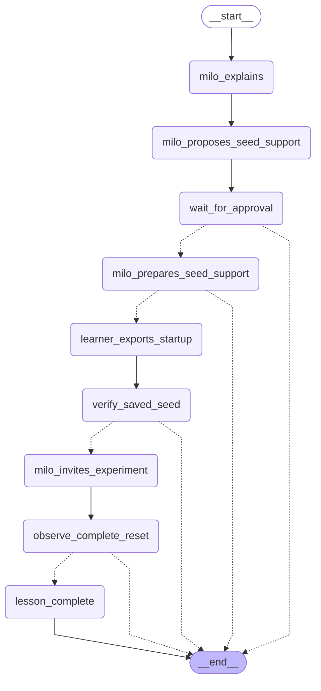

## Lesson 10: Change the running state (decaf)

[Read the script and graph](./src/coffee-shop/lessons/decaf.ts#L1).

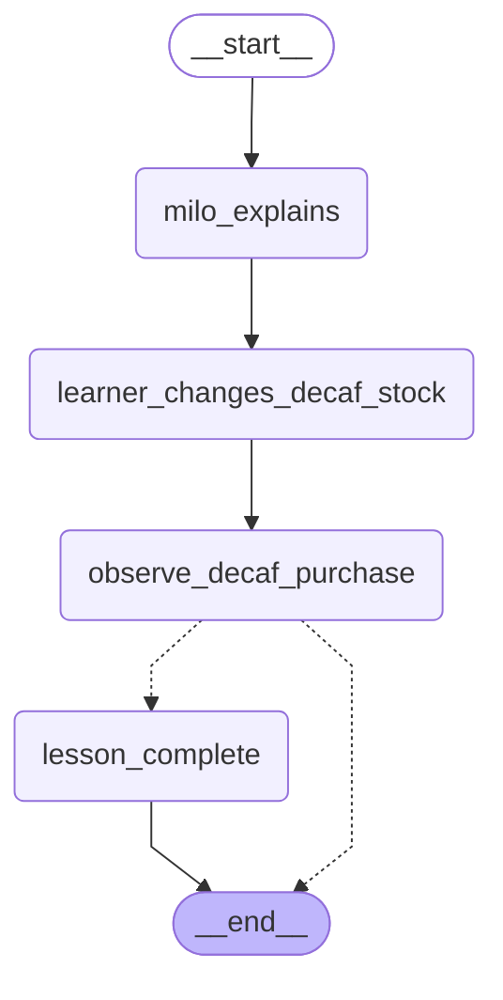

## Lesson 11: Add stock rules (rules)

[Read the script and graph](./src/coffee-shop/lessons/rules.ts#L1).

## Lesson 12: Make purchases reduce inventory (observe)

[Read the script and graph](./src/coffee-shop/lessons/observe.ts#L1).

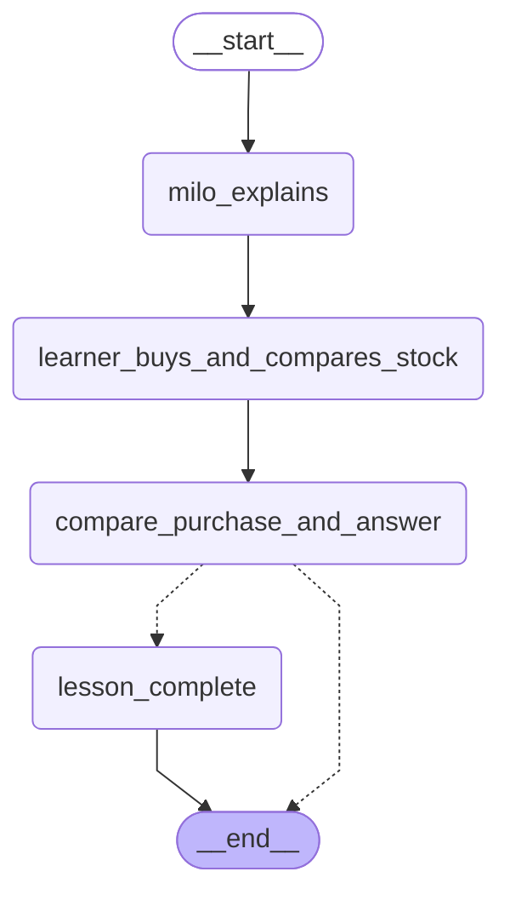

## Lesson 12: Make purchases reduce inventory (reduce)

[Read the script and graph](./src/coffee-shop/lessons/reduce.ts#L1).

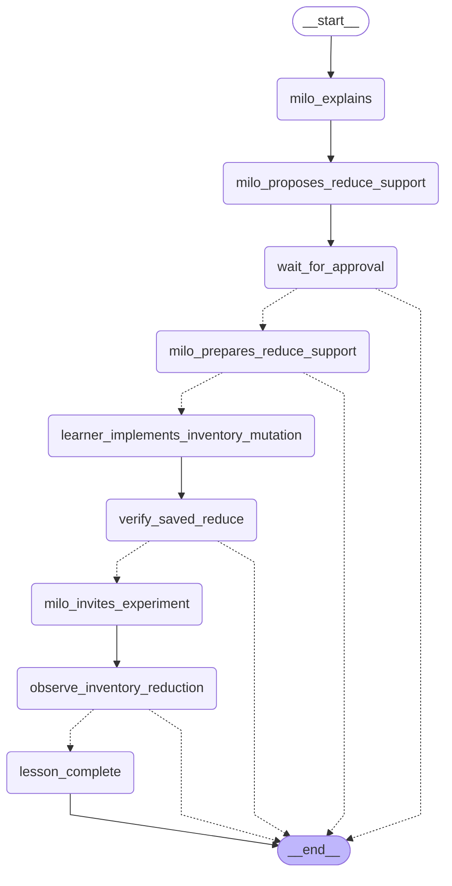

## Lesson 13: Exercise evolving state (sellout)

[Read the script and graph](./src/coffee-shop/lessons/sellout.ts#L1).

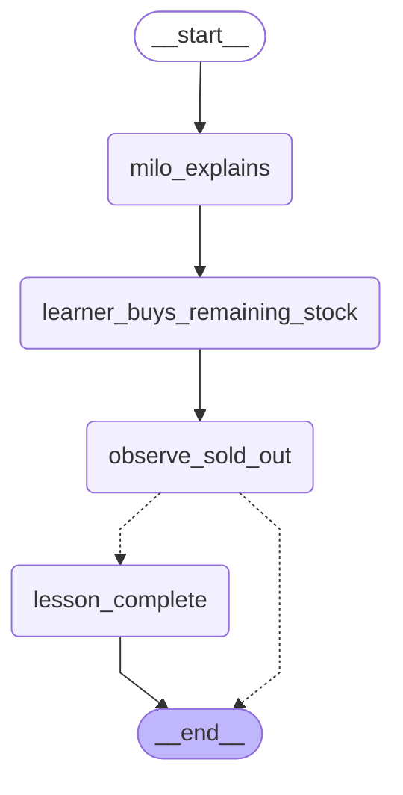

## Lesson 13: Exercise evolving state (restock)

[Read the script and graph](./src/coffee-shop/lessons/restock.ts#L1).

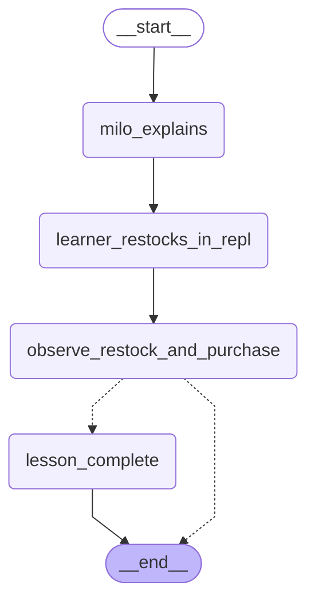

## Lesson 14: Save a reusable setup (scenario)

[Read the script and graph](./src/coffee-shop/lessons/scenario.ts#L1).

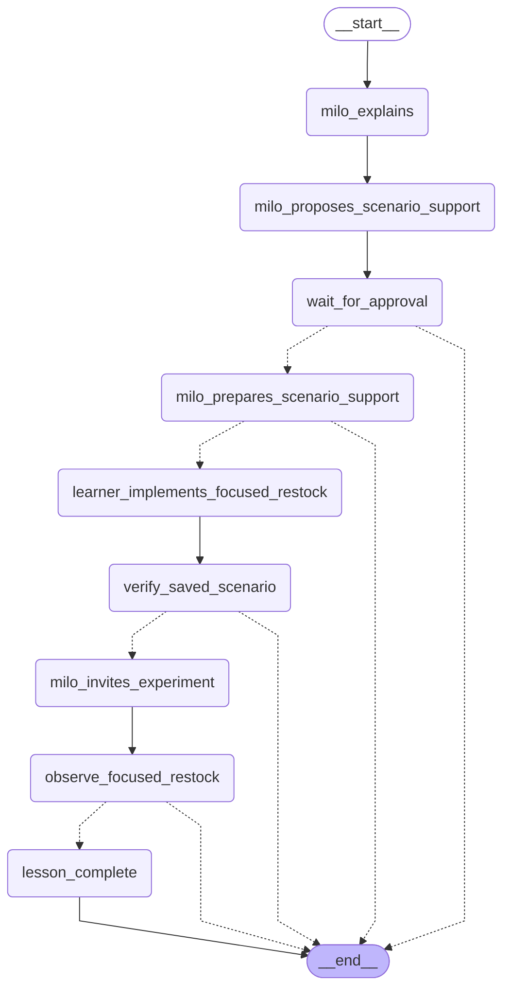
